# herdr-setup

My [Herdr](https://herdr.dev) desktop app setup.
The main piece is **Cozy Pixel**, a layout with a pixel-art sidebar: spaces and agents grouped by machine, and every agent shown as a cozy chibi character in its machine's scene.

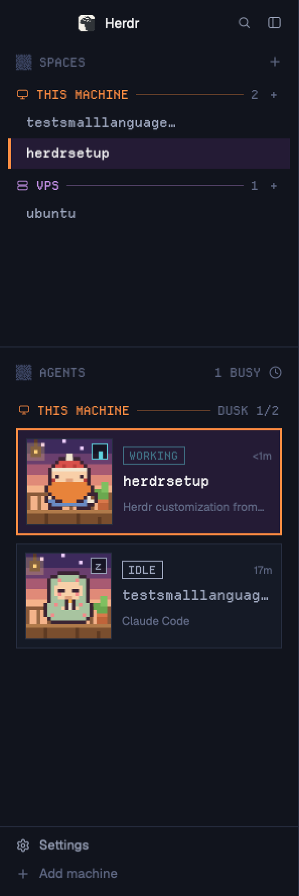

## Characters

Each space gets its own character, standing in its machine's scene: `DUSK` for this computer, then `DEN`, `GROVE`, `KEEP` or `CAVE` for the others.
Characters come in packs, and you can switch packs with one command.

### Cozy pack (default)

<table>
<tr>
<td align="center" width="25%">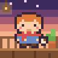<br><b>Knight</b><br>Off duty: messy hair, striped scarf, a mug of cocoa.</td>
<td align="center" width="25%">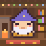<br><b>Wizard</b><br>Sleepy, in a floppy knit hat and a mustard sweater.</td>
<td align="center" width="25%">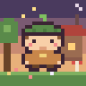<br><b>Ranger</b><br>A leaf-sprout beanie and a warm poncho.</td>
<td align="center" width="25%"><br><b>Dwarf</b><br>Pompom beanie, big ginger beard, a mug.</td>
</tr>
<tr>
<td align="center"><br><b>Cleric</b><br>Wrapped in a patchwork quilt, holding a candle.</td>
<td align="center">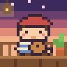<br><b>Bard</b><br>Beret, striped sweater, a ukulele.</td>
<td align="center">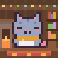<br><b>Cat</b><br>Grey tabby in a mustard scarf, with a ball of yarn.</td>
<td align="center">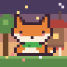<br><b>Fox</b><br>Green scarf and a white-tipped tail.</td>
</tr>
<tr>
<td align="center">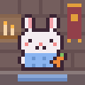<br><b>Bunny</b><br>Blue knit sweater, hugging a carrot.</td>
<td align="center"><br><b>Owl</b><br>Big round eyes, reading a red book.</td>
<td align="center"><br><b>Frog</b><br>Yellow raincoat and a big grin.</td>
<td align="center">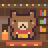<br><b>Bear</b><br>Red scarf, holding a honey pot.</td>
</tr>
<tr>
<td align="center">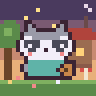<br><b>Raccoon</b><br>Teal hoodie, sneaking a cookie.</td>
<td align="center"><br><b>Penguin</b><br>Pink earmuffs and a red striped scarf.</td>
<td align="center"><br><b>Hedgehog</b><br>Spiky coat, holding a shiny red apple.</td>
<td align="center">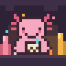<br><b>Axolotl</b><br>Frilly pink gills, hugging a bubble tea.</td>
</tr>
<tr>
<td align="center">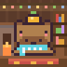<br><b>Capybara</b><br>Fresh from the hot spring: a yuzu on its head, a striped towel.</td>
<td align="center"><br><b>Red panda</b><br>Moss-green sweater, warming its paws on a mug of tea.</td>
<td align="center">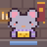<br><b>Mouse</b><br>Lilac cardigan, hugging a block of cheese.</td>
<td></td>
</tr>
</table>

### Christmas pack

The scenes go festive too: a garland of lights everywhere, and snow on the porch and in the garden.

<table>
<tr>
<td align="center" width="25%">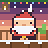<br><b>Santa</b><br>Pompom hat, fluffy beard, gold buckle.</td>
<td align="center" width="25%">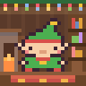<br><b>Elf</b><br>Pointy ears and a hat with a bell.</td>
<td align="center" width="25%">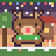<br><b>Reindeer</b><br>Antlers, a glowing red nose, a green scarf.</td>
<td align="center" width="25%"><br><b>Snowman</b><br>Red beanie, carrot nose, coal buttons.</td>
</tr>
<tr>
<td align="center">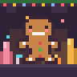<br><b>Gingerbread</b><br>Icing smile and candy buttons.</td>
<td></td>
<td></td>
<td></td>
</tr>
</table>

### Switch packs

On a Mac, press **⌘⌥P** (Command-Option-P) while the Cozy Pixel layout is shown to cycle packs, or use a terminal:

```sh
herdr-app do pixel-agents.next-pack        # cycle: Cozy -> Christmas -> Cozy
herdr-app do pixel-agents.pack-christmas   # pick one by name
herdr-app do pixel-agents.pack-cozy
```

A toast confirms the switch, and the choice survives restarts.

<details>
<summary><b>Every character on every scene</b></summary>

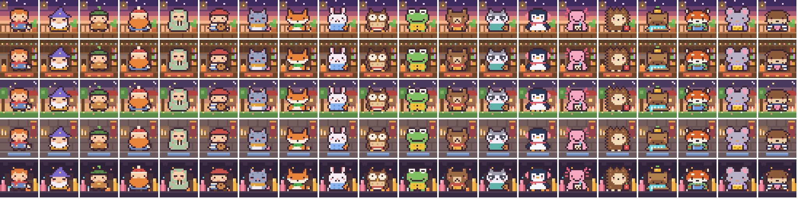

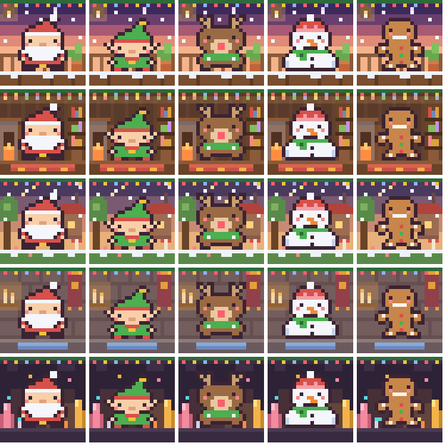

</details>

## Image and PDF previews

Click an image or a PDF in the Files panel (the **Files** button, top right) and it opens in a pane beside your terminal.
A single image fits the pane; a PDF shows every page, fit to the pane's width, and scrolls.
**Open in Preview** opens the file in macOS Preview.

From a terminal, add this to your `~/.zshrc`:

```sh
hview() { herdr-app do pane.split "{\"direction\":\"right\",\"mod\":\"file-preview\",\"props\":{\"file\":\"$(cd "$(dirname "$1")" && pwd)/$(basename "$1")\"}}"; }
```

Then `hview report.pdf` or `hview photo.png` opens it the same way.

- Formats: PNG, JPEG, GIF, WebP, SVG and PDF, plus HEIC, TIFF and BMP (converted by macOS).
- macOS only, and only files on this computer (not on a connected remote machine).
- PDFs are rendered with macOS PDFKit. The first PDF compiles a small renderer once, which takes a few seconds; this needs the Xcode Command Line Tools (`xcode-select --install`).

## Simulator pane

Press **⌘⌥S** (Command-Option-S) to open a booted iOS simulator or Android device live in a pane beside your terminal, or run `herdr-sim` in any pane.

- Click to tap, drag to swipe.
- Keys: `n` next device, `h` home, `b` back (Android), `t` type text, `d` dark/light, `s` screenshot to Desktop, `o` open Simulator.app, `B` boot an iPhone, `q` quit.
- Frames refresh about twice a second, and only when the screen changed.
- iOS shows live with just Xcode.
  Taps, swipes, typing and Home on iOS go through [Maestro](https://maestro.dev), because Apple's `simctl` cannot tap: `brew install mobile-dev-inc/tap/maestro openjdk@17`.
  The first step takes about 10 seconds while Maestro starts; after that each one takes about a second.
  Quitting stops Maestro and its iOS driver.
- Android works fully with `adb`.
- It draws with the Kitty graphics protocol, which Herdr terminals support, so each frame replaces the last and memory stays flat.

## Claude usage

The **USAGE** block at the bottom of the sidebar shows how much of your Claude plan you've used: the 5-hour session and the week, each with a pixel bar and the time left.
Under each bar, `RESET 12:50 · NEXT 17:50` says when that window last reset and when it resets next (dates for the week).
Bars turn orange at 70% and red at 90%.
Once a reset time passes, the row shows 0% and a green `RESET` until Claude Code sends the new numbers.

- The numbers come from Claude Code itself: it sends them to its status line command after each reply, and `bin/claude-usage-tap` saves them for Herdr.
  The block updates within 30 seconds of a Claude Code reply in any terminal.
- The header says how fresh the numbers are (`NOW`, `7M AGO`).
  The **↻** button, or `herdr-app do claude-usage.refresh`, asks Anthropic for the current numbers right away, the same ones `/usage` shows.
  To do that it uses Claude Code's login from your macOS Keychain: the token stays in memory, is never saved or logged, and only goes to `api.anthropic.com`.
  It uses the endpoint Claude Code's own `/usage` uses, which isn't a public API and could change.
- Pro and Max plans only; API-key usage has no plan limits to show.

## Install

Copy the layout into your Herdr app home, then switch to it:

```sh
cp -R pixel/layouts pixel/themes pixel/mods pixel/bin ~/.config/herdr-app/
ln -sf ~/.config/herdr-app/bin/herdr-sim ~/.local/bin/herdr-sim
for m in pixel-spaces pixel-agents pixel-files file-preview claude-usage; do herdr-app check ~/.config/herdr-app/mods/$m; done
herdr-app do layout.switch '{"name":"pixel"}'
```

For the **⌘⌥P** pack and **⌘⌥S** simulator shortcuts, add the `layout:pixel` section from `pixel/keys.json` to your `~/.config/herdr-app/keys.json` (merge it; don't replace the file).

For the Claude usage block, point Claude Code's status line at the tap once:

```sh
python3 ~/.config/herdr-app/bin/claude-usage-tap --install
```

This sets `statusLine` in `~/.claude/settings.json` and keeps any status line command you had as the next one in line, so it keeps working.
If another tool later resets the status line (Orca does when it updates), the USAGE block puts the tap back within 30 seconds, keeps that tool's new command running after it, and shows a toast.
To opt out, delete `~/.config/herdr-app/bin/claude-usage-next` first (that stops the repairs), then set your status line back.

Restart Herdr once so the pixel font loads.
`ctrl-shift-l` switches back to your previous layout.

The spaces mod runs `git` in each space's folder and `hc machine` commands, the same as Herdr's own spaces list.
None of the mods downloads anything from the internet; the only network call is the usage refresh button, to `api.anthropic.com`.

<details>
<summary><b>Change the art</b></summary>

Anyone who installed Cozy Pixel can change its art on their own machine.
Edit the installed copy in `~/.config/herdr-app/mods/pixel-agents/`, not the one in this repo: Herdr only reads its own folder.

1. Edit a grid in `sprites.py`, or add a new entry to `CHARS` there.
2. Run `python3 sprites.py` in that folder. Herdr picks up the new SVGs right away.
3. For a new character, also add its name to a pack's `chars` in `PACKS` in `main.js`. A new pack is a new entry in `PACKS`; `festive: true` makes it use the `-xmas` scenes.

To pin a machine to a scene, add it to `SCENE_OF` in `main.js`, e.g. `{ vps: "den" }`.

Want to share your changes back?
Fork this repo, copy your edited files into your fork's `pixel/mods/pixel-agents/`, and open a pull request.

</details>

<details>
<summary><b>What's in this repo</b></summary>

| Path | What it is |
|---|---|
| `pixel/` | The Cozy Pixel layout, in the herdr.dev layout format (`RECIPE.md`, `preview.png`, `layouts/`, `themes/`, `mods/`, `bin/herdr-sim`, `keys.json`). |
| `home/` | My `settings.json` and `keys.json`. |
| `docs/` | The README images: one card per character and the full sprite sheets. |
| `sync.sh` | Copies the live setup from `~/.config/herdr-app` into this repo. |

</details>

<details>
<summary><b>Owner notes: restore and sync</b></summary>

This repo is my backup.
On a new machine, after installing, I also copy my personal files:

```sh
cp home/settings.json home/keys.json ~/.config/herdr-app/
```

After changing anything in the app, I copy the live files in and push:

```sh
./sync.sh && git add -A && git commit -m "Sync Herdr setup" && git push
```

In a fork, `sync.sh` works the same way, but it also copies your own `settings.json` and `keys.json` into `home/`.

</details>

## License

Copyright 2026 Denny Raymond. Two licenses apply; [NOTICE](NOTICE) says exactly which files each covers.

- **Code** (the mods, the layout, the theme, the code in `sprites.py`, `sync.sh`): [Apache License 2.0](LICENSE). Use, change and share it, including commercially, keeping the license and NOTICE.
- **Pixel art** (the characters and scenes: their drawings in `sprites.py`, the SVGs, `docs/`, `preview.png`): [CC BY-NC 4.0](LICENSE-ART). Use, change and share it with credit to "Cozy Pixel art by Denny Raymond" and a link here, for non-commercial use only. Ask me for commercial use.
- `pixel-spaces` and `pixel-agents` are modified from the `spaces` and `agents` mods shipped with [Herdr](https://github.com/herdrdev/herdr-app) 0.1.15, also Apache 2.0. Each says what changed at the top of its `main.js`.
- [Departure Mono](https://departuremono.com) by Helena Zhang is under the SIL Open Font License 1.1 (`pixel/mods/pixel-spaces/fonts/LICENSE-DepartureMono.txt`), not Apache.
- The pixel art is original, drawn for this setup in a cozy chibi fantasy style inspired by [KayKit Adventurers](https://kaylousberg.itch.io/kaykit-adventurers). No KayKit assets are used.
