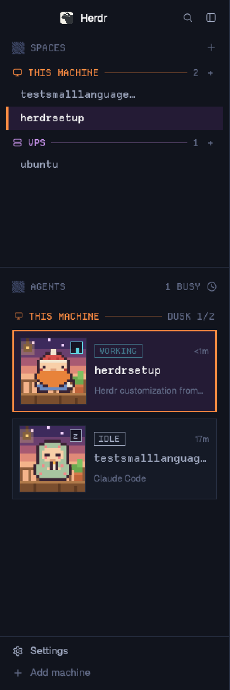

# Cozy Pixel

A cozy pixel-art sidebar for the Herdr app.
Spaces and agents are grouped by machine under colored pixel-font headers.
Every agent is a card with a chibi fantasy adventurer standing in its machine's scene, a boxed status badge, its space name and what it is working on.
The rest of the window is Herdr's main layout in a dark navy theme with an orange accent.

## What you see

The window is Herdr's `main` layout with a 296px sidebar on the left.

**Sidebar, top to bottom:**

1. Brand bar (46px, shipped `workspace-chrome`).
2. Spaces (weight 1):
   - A header `▒▒ SPACES` in Departure Mono 12px, `dim` color, with a `+` on the right.
   - One header per machine: a monitor icon (this computer) or server icon (others), the machine name in uppercase (`THIS MACHINE` for this computer), a 1px rule, the space count and a `+`.
   - Each machine header and its rule are in that machine's color: this computer `#ff8c42`, other machines pick from `#f2b34a`, `#5fd3e0`, `#c792ea`, `#7fe08a`, `#ff7aa8` by a hash of their name.
   - Space rows are 30px, Departure Mono 13px, indented 18px, with no avatar tile.
   - The active space is `foreground` on `selected` (`#241b35`) with a 3px `accent` bar on its left edge; others are `muted`.
3. Agents (weight 1.6):
   - A header `▒▒ AGENTS` on the left and `N BUSY` plus the sort icon on the right.
   - One header per machine in its color: icon, uppercase name, rule, then the scene name and busy/total, e.g. `DUSK 1/2`.
   - One card per agent: 8px margin sides, 4px top and bottom, 8px padding, 10px gap, `surface` background, 1px `border`.
   - Card left: an 86px framed square with two 84px pictures stacked: the machine's scene, then the space's adventurer.
   - A 16px glyph box sits in the picture's top-right corner, in the status color.
   - Card right, stacked: the status badge (Departure Mono 11px, 1px border in the status color, 18px tall) with the time since the last change at the far right; the space name (Departure Mono 13.5px); the tab or agent title (11.5px, `dim`, truncated).
4. Footer (69px, shipped `workspace-chrome`: Settings, Add machine).

**Theme `pixel`:** terminal background `#10131b`, `canvas` `#0c0f16`, `chrome` `#11141d`, `surface` `#151a26`, `border` `#262d3f`, `accent` `#ff8c42`, `working` `#5fd3e0`, `blocked` `#ff5e6c`, `done` `#7fe08a`, `idle` `#9aa3ba`.
The focused pane's border and the cursor are orange.

**Scenes (24x24 pixel art, one per machine):**

- `DUSK`: a porch at sunset with a hanging lantern, a railing and a potted plant. Always this computer.
- `DEN`: a cabin room with string lights, a fireplace, a bookshelf and a red rug.
- `GROVE`: a cottage garden at golden hour with a lit window, chimney smoke, a tree, fireflies and a mushroom.
- `KEEP`: a candlelit stone nook with a side tapestry and a blue cushion.
- `CAVE`: a campfire grotto with warm crystals and glowing mushrooms.

**Adventurers (16x16 chibi sprites, plum outline `#3b2433`, blush cheeks):** a knight with a scarf and cocoa, a wizard in a knit hat and sweater, a ranger in a leaf beanie and poncho, a dwarf with a pompom beanie and mug, a cleric wrapped in a quilt holding a candle, a bard in a beret playing a ukulele, a grey tabby cat in a mustard scarf with a ball of yarn, a fox in a green scarf with a white-tipped tail, a bunny in a blue sweater hugging a carrot, an owl reading a red book, a frog in a yellow raincoat, a bear in a red scarf holding a honey pot.

## How it behaves

- **working:** cyan `WORKING` badge whose opacity pulses from 0.45 to 1 every 1.2s; the corner glyph cycles quadrant blocks every 180ms.
- **blocked:** red `NEEDS YOU` badge, a `!` in the corner and a red card border.
- **done:** green `DONE` badge and a `*` in the corner.
- **idle:** grey `IDLE` badge and a `z` in the corner; the space name dims to `muted`.
- The focused agent's card gets a 2px `accent` border on `selected`.
- Clicking a card focuses that agent's pane. Hovering a card swaps the time for a pin button.
- Clicking a machine header in the agents list folds it (a chevron shows while folded).
- The sort icon opens a popup: Priority (most urgent first) or Grouped by space; either way the groups stay per machine and pinned agents come first in each.
- The spaces list keeps the shipped behavior: click to switch, drag to reorder within a machine, right-click for the space menu, `+` for a new space on that machine, click a machine header to fold it.
- Each space keeps its adventurer across restarts: a hash of the space name picks one, and the next free one if taken, so up to twelve spaces never share.

## Built from

- `layouts/pixel.json`: a clone of `main` (`layout.clone`) with root `"theme": "pixel"`, `"font_size": 13`, `sidebar` at `{ "px": 296 }`, `agents` at `{ "weight": 1.6 }`, and the `spaces` and `agents` blocks pointing at `pixel-spaces` and `pixel-agents`.
- `themes/pixel.json`: background, foreground, selection, cursor, 16 ANSI colors and the panel color overrides listed above.
- `mods/pixel-spaces`: a clone of the shipped `spaces` mod with a new header, machine headers and rows. It keeps the shipped git lookups (`exec("git", ...)` per space folder, on remote machines too) and `hc machine ls` / `hc machine add` for machine status and reconnecting. It ships the font in `fonts/` (Departure Mono, SIL OFL 1.1).
- `mods/pixel-agents`: a clone of the shipped `agents` mod. Agents are grouped by `machineOf(a)` (the address prefix before `/`), and `setAgentOrder` gets the same machine-grouped order so `agent.next` follows the cards.
  The scene is `SCENE_OF[machine]` if set, else picked by a hash of the machine name from `den`, `grove`, `keep`, `cave`; this computer is always `dusk`.
- The pictures are `image()` of SVGs in `mods/pixel-agents/scenes/` and `chars/`, with `shape-rendering="crispEdges"`. `sprites.py` draws them from text grids and rewrites them when run.
- Icons come from the shipped `mods/workspace-chrome/*.svg`.
- Neither mod downloads anything from the internet (`hc machine add` reconnects a machine over its own SSH target).

## Watch out

- Departure Mono loads at start or on the next look change: restart Herdr (or change the theme once) after copying, or the headers fall back to the default font.
- 84px pictures are 3.5 logical pixels per art pixel: crisp on a 2x Retina screen (7 device pixels), slightly uneven at 1x. Use 72 or 96 on a 1x screen.
- Thirteen or more spaces with agents repeat adventurers. Add sprites to `CHARS` in `sprites.py` and add their names to `AVATARS` in `main.js`.
- `SCENE_OF` in `pixel-agents/main.js` pins scenes by machine name (`{ vps: "den" }` here); a machine not listed gets a hashed scene.
- The machine color table is duplicated in both mods (mods cannot import each other at run time); change both together.
- Both mods are clones of Herdr 0.1.15's. A later Herdr may change the shipped mods; these stay as they are.

## Done when

- `herdr-app check mods/pixel-spaces` and `herdr-app check mods/pixel-agents` pass.
- `herdr-app do layout.switch '{"name":"pixel"}'` shows the navy window with `▒▒ SPACES` and `▒▒ AGENTS` in the pixel font.
- With an agent running on this computer, the agents list shows `THIS MACHINE ... DUSK n/m` and a card with the porch scene and an adventurer.
- Starting a task in that agent turns its badge to a pulsing `WORKING` and its corner glyph animates; when it finishes and you look, it returns to `IDLE` with a `z`.
- `herdr-app status` lists no errors.
